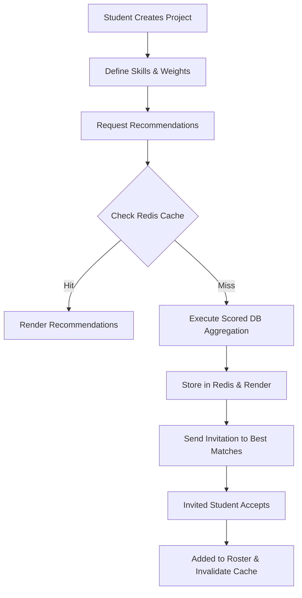
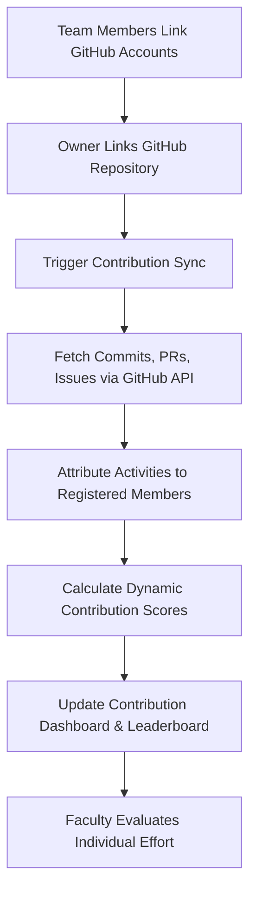

# Product Requirements Document (PRD)

## Project Name: SkillSphere 🎓
**Tagline:** Smart Student Collaboration & Project Intelligence Platform  
**Document Version:** 2.0.0  
**Status:** Approved / Production Ready  
**Target Release:** Academic Year 2026  
**Authors:** SkillSphere Core Engineering & Product Team  

---

## 1. Executive Summary

### 1.1 Product Vision
**SkillSphere** is an end-to-end academic and technical project collaboration platform designed to eliminate friction in student team formation, project tracking, and academic mentorship. By merging intelligent skill-matching algorithms, automated resume skill extraction, GitHub contribution telemetry, and institutional faculty oversight, SkillSphere bridges the gap between individual student potential and high-performing collaborative teams.

### 1.2 Core Value Proposition
- **For Students:** Find compatible project teammates based on verified competencies, track task progress transparently, build an endorsed technical portfolio, and have authentic GitHub contributions recognized.
- **For Project Leads:** Form balanced teams matching specific technical prerequisites, monitor workload distribution, and manage sprints with built-in task boards.
- **For Faculty Mentors:** Gain real-time visibility into project health, approve milestone progressions, evaluate individual versus group performance through quantitative GitHub analytics, and endorse student competencies.
- **For Institutions:** Standardize project-based learning evaluation with automated audit trails and verified project deliverables.

---

## 2. Target Audience & User Personas

### 2.1 Persona 1: The Student Project Seeker (Aarav, 3rd Year CSE)
- **Motivations:** Wants to join an impactful AI/Web project, needs teammates with complementary skills (e.g., backend, UI/UX).
- **Pain Points:** Hard to know who possesses genuine technical skills; awkward manual outreach via WhatsApp/Discord; unbalanced team workloads.
- **Needs in SkillSphere:** Skill-filtered project discovery, automated match scores, resume skill import, real-time team chat, and individual contribution recognition.

### 2.2 Persona 2: The Project Lead / Creator (Neha, 4th Year IT)
- **Motivations:** Leading a capstone project; needs dedicated front-end and cloud engineers with proven track records.
- **Pain Points:** Students committing to teams and becoming inactive; inability to monitor task progress objectively.
- **Needs in SkillSphere:** Skill-weighted candidate recommendations, join-request management, Kanban-style task assignments with deadlines, and GitHub commit tracking.

### 2.3 Persona 3: The Faculty Mentor (Dr. Sharma, Department of Computer Science)
- **Motivations:** Overseeing 20+ capstone projects; responsible for evaluating individual contribution parity and project validity.
- **Pain Points:** Free-rider problem where 1-2 students do all work while others get equal grades; manual verification of code repositories is tedious.
- **Needs in SkillSphere:** Faculty approval dashboard, automated GitHub contribution scorecards (commits, PRs, code reviews, LOC), and skill endorsement capabilities.

### 2.4 Persona 4: The Platform Administrator
- **Motivations:** Ensure platform integrity, security, and uptime across departments.
- **Needs in SkillSphere:** Role-based access control (RBAC), centralized rate limiting, audit logging, and cache metrics monitoring.

---

## 3. Problem Statement & Market Opportunity

| Problem in Academic Collaboration | Current Workaround | SkillSphere Solution |
| :--- | :--- | :--- |
| **Inefficient Team Formation** | Manual cold-messaging, peer friend groups | Heuristic match engine scoring compatibility across required skills, proficiency levels, and active workload |
| **Skill Self-Reporting Bias** | Inflated resume claims | Peer & faculty endorsements, automated resume OCR parsing, and verified GitHub contributions |
| **Free-Rider Dilemma** | Group grading with no visibility | Real-time GitHub webhook/API integration tracking commits, PRs, issues, and code changes with gamified scoring |
| **Fragmented Communication** | Slack, WhatsApp, Trello, Google Drive | Integrated workspace featuring project chat, Kanban task boards, todo lists, and automated email notifications |
| **Faculty Disconnect** | Mid-term viva presentations | Direct faculty milestone sign-off and continuous contribution analytics dashboard |

---

## 4. Product Scope & Functional Requirements

### 4.1 Authentication & Role-Based Access Control (RBAC)
- **FR-AUTH-01:** System shall support user registration and authentication with Email/Password and GitHub OAuth 2.0.
- **FR-AUTH-02:** System shall support three distinct system roles: `STUDENT`, `FACULTY`, and `ADMIN`.
- **FR-AUTH-03:** Passwords must be hashed using bcrypt prior to database persistence.
- **FR-AUTH-04:** Authentication sessions shall be managed via JWT (JSON Web Tokens) with a 7-day expiration window.
- **FR-AUTH-05:** GitHub OAuth flow shall auto-link accounts by matching verified emails or allow manual in-app profile linkage.

### 4.2 Student Profile & Competency Management
- **FR-STU-01:** Students can configure branch, academic year (1 to 5), and current availability status (`available` vs. `busy`).
- **FR-STU-02:** Students can add skills along with proficiency ratings (Level 1 to 5).
- **FR-STU-03:** Faculty mentors and peers can endorse specific student skills, visually displayed via endorsement badges.
- **FR-STU-04:** Resume Parsing: Students can upload resume PDFs/images. The system uses OCR and lexical pattern matching to extract recognized technical skills and automatically populate their profile.

### 4.3 Intelligent Skill Matching & Candidate Recommendation
- **FR-MATCH-01:** Project owners can request intelligent candidate recommendations for any open project.
- **FR-MATCH-02:** The recommendation engine shall calculate a composite compatibility score based on:
  - Technical skill overlap against project requirements.
  - Required skill weights (1 to 10).
  - Proficiency level multiplier ($0.40 + 0.60 \times \frac{\text{level}}{5}$).
  - Endorsement count bonus (+3% per endorsement, capped at +15%).
  - Availability modifier (Full score for available, -15% penalty for busy).
  - Active workload penalty (-5% per active task assigned across other projects).
- **FR-MATCH-03:** Matching results shall be cached in Redis with project-level key invalidation upon roster updates.

### 4.4 Project Lifecycle & Team Management
- **FR-PROJ-01:** Students can create projects specifying title, description, required skills (with weights), and minimum match threshold.
- **FR-PROJ-02:** Project lifecycle states: `OPEN` $\rightarrow$ `IN_PROGRESS` $\rightarrow$ `CLOSED` $\rightarrow$ `COMPLETED`.
- **FR-PROJ-03:** Team invitation system: Project owners can invite eligible candidates directly via platform notification and email.
- **FR-PROJ-04:** Join-request system: Students can submit join requests; owners can accept or decline with automatic roster updates.
- **FR-PROJ-05:** Faculty approval gate: Projects require faculty verification before attaining `isFacultyApproved: true` status.

### 4.5 Task & Workload Management
- **FR-TASK-01:** Project owners and team members can create tasks with deadlines, descriptions, and required skill tags.
- **FR-TASK-02:** Task workflow status: `TODO` $\rightarrow$ `IN_PROGRESS` $\rightarrow$ `PENDING_REVIEW` $\rightarrow$ `COMPLETED`.
- **FR-TASK-03:** Personal Todo list: Students have a private personal todo system for granular day-to-day progress tracking.

### 4.6 GitHub Telemetry & Contribution Tracking
- **FR-GIT-01:** Project owners can link public GitHub repositories (`owner/repo-name`) to their projects.
- **FR-GIT-02:** One-click synchronization pulls commits, pull requests, issues, and code review activity.
- **FR-GIT-03:** Telemetry parser attributes contributions to registered project members based on verified GitHub usernames.
- **FR-GIT-04:** Automated scoring engine computes contribution points:
  - Commit: 5 base points (+ LOC bonus up to 20 pts).
  - Pull Request: 20 base points (+10 bonus if merged).
  - Issue: 10 base points.
  - Code Review: 15 base points.
  - Merge: 25 base points.
- **FR-GIT-05:** A dedicated Contribution Analytics Dashboard displays member rankings, code velocity, and activity breakdowns.

### 4.7 Communication & Notifications
- **FR-COMM-01:** Integrated project chat with message persistence and historical log retrieval.
- **FR-COMM-02:** Real-time event notifications for invitations, task deadlines, faculty decisions, and join requests.
- **FR-COMM-03:** SMTP transactional email notifications for invitations, project acceptances, and task milestone alerts.

---

## 5. Non-Functional Requirements (NFRs)

### 5.1 Performance & Latency
- **NFR-PERF-01:** Recommendation engine queries must respond within $< 150\text{ ms}$ on cache hit, and $< 800\text{ ms}$ on cache miss.
- **NFR-PERF-02:** Static frontend assets delivered with client-side caching; initial load time $< 2.0\text{ s}$ over broadband.
- **NFR-PERF-03:** Database indexing must maintain $O(\log N)$ query complexity for role, skill, and project searches.

### 5.2 Security & Privacy
- **NFR-SEC-01:** OWASP Top 10 compliance: Strict Helmet security headers, NoSQL query sanitization, and input validations.
- **NFR-SEC-02:** Rate Limiting: API gateway throttling capped at 100 requests per 15-minute window per IP to prevent brute-force and DoS attacks.
- **NFR-SEC-03:** Secret tokens (JWT secrets, GitHub OAuth client secrets, SMTP passwords) strictly managed via environment variables and Kubernetes secrets.

### 5.3 Reliability & Availability
- **NFR-REL-01:** Service uptime target of 99.9% in production environments.
- **NFR-REL-02:** Graceful degradation: If Redis cache becomes unreachable, the backend automatically falls back to MongoDB querying without crashing.

### 5.4 Scalability & Cloud Native Deployment
- **NFR-SCA-01:** Full containerization via Docker multi-stage builds.
- **NFR-SCA-02:** Production-ready Kubernetes (k8s) manifests supporting horizontal pod autoscaling (HPA), readiness and liveness health probes, and isolated namespace configuration.

---

## 6. User Journeys & Workflow Diagrams

### 6.1 Team Formation & Invitation Workflow

### 6.2 GitHub Contribution Sync & Evaluation Workflow

---

## 7. Success Metrics & Key Performance Indicators (KPIs)

1. **Match Quality Rate:** $> 80\%$ of accepted team invitations initiated via the recommendation engine.
2. **Evaluation Efficiency:** $60\%$ reduction in faculty grading time through automated GitHub contribution scorecards.
3. **Collaboration Velocity:** Average project sprint completion time reduced by $25\%$ using integrated task boards.
4. **Cache Efficiency:** $> 75\%$ Redis hit ratio on high-frequency candidate recommendation endpoints.
5. **System Uptime:** $99.9\%$ uptime during academic evaluation periods.

---

## 8. Release Roadmap

- **Phase 1 (MVP - Completed):** Core RBAC, Profile management, Project creation, Basic recommendation heuristic, Task board.
- **Phase 2 (Collaboration & GitHub - Completed):** GitHub OAuth, Contribution telemetry sync, Scoring engine, Redis caching, SMTP notifications.
- **Phase 3 (Enterprise & Scalability - Current):** Kubernetes manifests, Ingress controller, Horizontal autoscaling, PDF/OCR resume parsing.
- **Phase 4 (Future Roadmap):** AI-powered semantic matching using vector embeddings, automated code quality analysis with SonarQube integration, and mobile native companion application.
